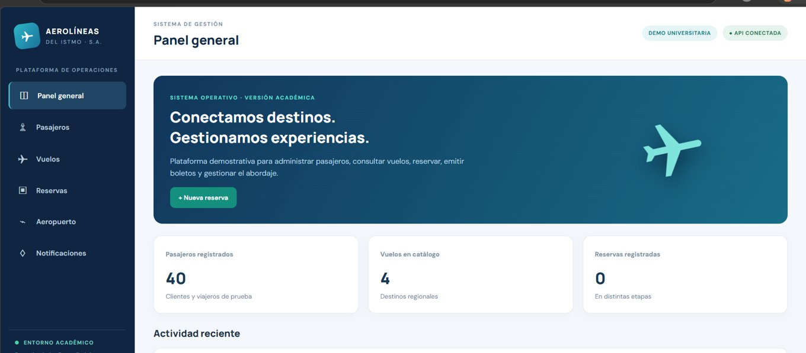

# ✈️ Aerolíneas del Istmo, S. A.

### Sistema de Gestión de Reservas y Abordaje

Proyecto académico de **Desarrollo Web — Ingeniería en Sistemas**. Aplicación demostrativa construida con **Domain Driven Design (DDD)**, **Arquitectura Hexagonal (Puertos y Adaptadores)** y documentación **C4**, con base de datos SQL en la nube.

> **🚀 [ABRIR LA APLICACIÓN WEB — DEMO EN VIVO](https://mmarcos00.github.io/aerolineas-istmo/)**  
> **📘 [VER DOCUMENTACIÓN COMPLETA EN PDF](docs/Documentacion_Aerolineas_del_Istmo.pdf)**  
> **📊 [ABRIR DIAGRAMAS DDD Y C4 EN DRAW.IO](diagrams/Arquitectura_Aerolineas_Istmo.drawio)**



*Captura realizada durante las pruebas del panel. Los contadores actuales del entorno público pueden variar.*

---

## 👨‍💻 Información académica

| Campo | Información |
|---|---|
| **Estudiante** | Marcos Emanuel Méndez Ortega |
| **Carné** | 0905-23-5324 |
| **Carrera** | Ingeniería en Sistemas |
| **Curso** | Desarrollo Web |
| **Sección** | 3 |
| **Proyecto** | Aerolíneas del Istmo, S. A. |
| **Fecha** | Noviembre de 2026 |
| **Repositorio** | [MMarcos00/aerolineas-istmo](https://github.com/MMarcos00/aerolineas-istmo) |

## 🎯 Objetivo

Construir una aplicación para administrar pasajeros, vuelos, reservas, emisión de boletos, check-in y abordaje. El sistema sustituye conceptualmente a un software monolítico, separando las **reglas del negocio** de la tecnología para permitir, en el futuro, otros canales de acceso sin duplicar su lógica.

La aplicación publicada es **una demostración educativa con datos ficticios**, no un sistema de venta de boletos comerciales.

## 🌐 Enlaces para la evaluación

| Recurso | Abrir |
|---|---|
| **Aplicación web pública** | **[Entrar al sistema de la aerolínea](https://mmarcos00.github.io/aerolineas-istmo/)** |
| Documentación paso a paso | [PDF con capturas, diagramas, fragmentos de código y pruebas](docs/Documentacion_Aerolineas_del_Istmo.pdf) |
| Código fuente | [Repositorio GitHub](https://github.com/MMarcos00/aerolineas-istmo) |
| API publicada | [Comprobación `/health`](https://aerolineas-istmo-api.mendezmarcosgt.workers.dev/health) |
| Modelo C4 y DDD | [Archivo editable de 6 diagramas draw.io](diagrams/Arquitectura_Aerolineas_Istmo.drawio) |
| Flujo de RN-07 | [Diagrama de cambio con penalidad](diagrams/Flujo_Cambio_Boleto_RN07.drawio) |
| Diseño estratégico | [FASE_1_DDD.md](analysis/FASE_1_DDD.md) |
| Verificación del proyecto | [INFORME_VERIFICACION_REQUISITOS.md](INFORME_VERIFICACION_REQUISITOS.md) |

> **Para el catedrático:** no es necesario instalar nada. Haga clic en **Entrar al sistema de la aerolínea**. Puede explorar los módulos y probar operaciones utilizando exclusivamente los datos ficticios de la demostración.

## 🏗️ Arquitectura tecnológica

```text
NAVEGADOR DEL USUARIO
         │
         ▼
GITHUB PAGES (HTML / CSS / JavaScript)
         │   HTTPS / API REST
         ▼
CLOUDFLARE WORKERS (TypeScript)
  ├── Adaptador de entrada HTTP (src/index.ts)
  ├── Aplicación / casos de uso (AerolineaService)
  ├── Dominio / reglas del negocio (PoliticaDeReservas)
  ├── Puerto de repositorio (PuertoRepositorioAerolinea)
  └── Adaptador de salida SQL (D1Repositorio)
         │
         ▼
CLOUDFLARE D1 (BASE DE DATOS SQL / SQLITE)
```

| Tecnología | Función |
|---|---|
| **WebStorm** | Entorno de desarrollo |
| **HTML, CSS y JavaScript** | Interfaz web y navegación |
| **TypeScript** | API y validaciones del dominio |
| **Cloudflare Workers** | Backend REST público |
| **Cloudflare D1 / SQLite** | Persistencia remota |
| **Git + GitHub** | Historial de cambios |
| **GitHub Pages** | Publicación estática gratuita |
| **draw.io** | Modelo C4, Context Map y diagramas SQL |

### DDD — Domain Driven Design

- **Lenguaje ubicuo:** glosario de 32 términos presentes en la documentación.
- **Core:** Reservas y Tarifas.
- **Soporte:** Vuelos, Inventario de asientos, Pasajeros y Operaciones de aeropuerto.
- **Genéricos:** Pagos, Notificaciones y Autenticación (simulada o prevista para una extensión futura).
- **Bounded Contexts:** Vuelos, Reservas, Inventario, Pasajeros, Aeropuerto, Pagos y Notificaciones.
- **Dominio táctico:** entidades, políticas, estado de la reserva e instantánea histórica de tarifa.

### Arquitectura Hexagonal

Las reglas RN-01 a RN-08 se implementan en `api/src/domain/policies.ts`, fuera de los controladores y de las consultas SQL. Los casos de uso de `AerolineaService` dependen del contrato `PuertoRepositorioAerolinea`, implementado por `D1Repositorio`.

### Modelo C4

1. **Contexto:** sistema, agentes y personal del aeropuerto, más integraciones futuras.
2. **Contenedores:** navegador, frontend GitHub Pages, API Worker y D1.
3. **Componentes:** HTTP, aplicación, políticas, puerto y adaptador SQL.
4. **Código:** entidades, interfaces y clases relevantes.

Los contextos están **separados lógicamente** dentro de un Worker; **no** se desplegaron microservicios independientes. Las ACL para pagos y migración son propuestas de diseño, no conexiones reales.

## 🧩 Funciones implementadas

| Código | Función | Estado en la demostración |
|---|---|---|
| RF-01 | Registro de pasajeros, documento, nivel y crédito | ✅ Implementado |
| RF-02 | Búsqueda de vuelos por origen, destino y fecha | ✅ Implementado |
| RF-03 | Crear, editar borrador y confirmar reservas | ✅ Implementado |
| RF-04 | Tarifas, equipaje y descuentos automáticos | ✅ Implementado |
| RF-05 | Descontar cupos al confirmar | ⚠️ Sin bloqueo atómico concurrente |
| RF-06 | Borrador, Confirmada, Boleto emitido, Check-in, Abordado, Cancelada | ✅ Implementado |
| RF-07 | Historial por pasajero y agente | ✅ Implementado |
| RF-08 | Avisos por horario, puerta o cancelación | ⚠️ Notificaciones internas |

Funciones adicionales de la versión 2: **cambio de boleto con penalidad simulada, cancelación con penalidad y manifiesto de pasajeros**.

### Reglas de negocio RN-01 a RN-08

| Regla | Aplicación |
|---|---|
| **RN-01** | Individuales: de 1 a 9 pasajeros. Grupos de 10 o más: agencia/corporativo. |
| **RN-02** | Crédito suficiente para agencia/corporativo; pago individual antes de emisión. |
| **RN-03** | Capacidad máxima; sobreventa hasta el 5% solo en económica autorizada. |
| **RN-04** | Más de 10 pasajeros: 5% de descuento; más de 30: 10%. |
| **RN-05** | Cancelaciones autorizadas con al menos 3 horas antes del vuelo. |
| **RN-06** | Documento válido al menos seis meses para vuelo internacional. |
| **RN-07** | Un boleto emitido no se edita directamente; cambio/cancelación con penalidad simulada. |
| **RN-08** | Cada boleto guarda su tarifa original, incluso ante cambios posteriores. |

## 🗃️ Organización del proyecto

```text
aerolineas-istmo/
├── analysis/
│   └── FASE_1_DDD.md
├── api/
│   ├── migrations/
│   │   ├── 0001_inicial.sql
│   │   └── 0002_cambios_con_penalidad.sql
│   ├── src/
│   │   ├── application/  # AerolineaService y puertos
│   │   ├── domain/       # Entidades y reglas RN-01 a RN-08
│   │   ├── infrastructure/ # Adaptador SQL D1
│   │   └── index.ts      # API HTTP
│   ├── package.json
│   └── wrangler.toml
├── diagrams/             # 6 diagramas C4/DDD/SQL + RN-07
├── docs/
│   ├── assets/vista_panel.jpg
│   ├── Documentacion_Aerolineas_del_Istmo.pdf
│   ├── index.html
│   ├── app.js
│   ├── api-client.js
│   ├── config.js
│   └── styles.css
├── tests/                # Dominio e integración
├── README.md
├── GUIA_WEBSTORM_PASO_A_PASO.md
└── INFORME_VERIFICACION_REQUISITOS.md
```

## 💻 Instalación local para desarrolladores

**Requisitos:** Node.js y npm, Git y WebStorm (u otro editor). Para la API remota se requiere una cuenta Cloudflare Free.

```powershell
git clone https://github.com/MMarcos00/aerolineas-istmo.git
cd aerolineas-istmo\api
npm install
npm run db:local
npm run dev
```

La API local se ejecuta normalmente en `http://127.0.0.1:8787`.

En **otra terminal**, desde la carpeta principal del repositorio:

```powershell
node frontend-server.cjs
```

Abre `http://127.0.0.1:5500` en tu navegador.

**Atención:** `docs/config.js` contiene por defecto la URL de la **API pública**; si deseas trabajar exclusivamente con tu base local, cámbiala temporalmente a `http://127.0.0.1:8787`. No publiques ese cambio local si quieres mantener la demo conectada a la base en la nube.

### Migraciones y despliegue del backend (solo para quien administra Cloudflare)

```powershell
cd api
npx wrangler login
npm run db:remota
npx wrangler deploy
```

> No es necesario repetir `d1 create` si la base ya existe. Para una cuenta diferente, primero crea su propia D1 y configura el identificador en `api/wrangler.toml`.

### Ejecutar las pruebas

```powershell
cd api
npm run types
npm run test
npm run test:integration
```

**Resultados de la versión 2:** 9 pruebas de dominio y 12 de integración aprobadas (21 en total), según los registros de ejecución del proyecto.

## 📖 Documentación por fases

El documento **[Documentación completa en PDF](docs/Documentacion_Aerolineas_del_Istmo.pdf)** incluye:

- Caso de estudio y alcance.
- Fase DDD: vocabulario, subdominios, bounded contexts y Context Map.
- DDD táctico: políticas e invariantes del negocio.
- Arquitectura Hexagonal y fragmentos de código.
- Modelo C4: cuatro niveles y esquema de base de datos.
- SQL, migraciones, creación de API y desarrollo frontend.
- Evidencias mediante capturas proporcionadas durante el desarrollo.
- Pruebas y publicación paso a paso en Cloudflare y GitHub Pages.
- Conclusiones, limitaciones y recomendaciones.

## ⚠️ Limitaciones y seguridad

**Este proyecto es únicamente académico y utiliza datos de prueba.** No tiene autenticación/autorización real; cualquier persona con acceso al servicio público podría modificar los datos ficticios.

- Los pagos, las penalidades y los reembolsos son **simulados**.
- No se envían mensajes por correo, SMS ni WhatsApp: se consultan en el buzón interno.
- La validación de cupos no asegura atomicidad para ventas simultáneas de alta demanda.
- Los contextos DDD no equivalen a microservicios desplegados por separado.
- No están implementadas la app móvil, el portal exclusivo de agencias ni los quioscos de autoservicio.
- Los datos de vuelos de muestra dependen de la fecha de las migraciones; deben renovarse si vencen.
- No se deben registrar datos verdaderos de pasajeros, documentos de viaje ni información financiera.

## ✅ Entrega al catedrático

**Primero:** [Abrir la aplicación web](https://mmarcos00.github.io/aerolineas-istmo/).  
**Segundo:** [Leer el PDF de documentación](docs/Documentacion_Aerolineas_del_Istmo.pdf).  
**Tercero:** [Revisar el código](https://github.com/MMarcos00/aerolineas-istmo) y los [diagramas draw.io](diagrams/Arquitectura_Aerolineas_Istmo.drawio).

---

**Autor:** Marcos Emanuel Méndez Ortega · **Carné:** 0905-23-5324  
**Desarrollo Web · Sección 3 · Ingeniería en Sistemas · 2026**
